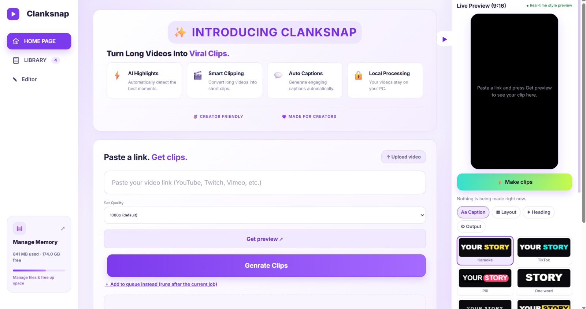
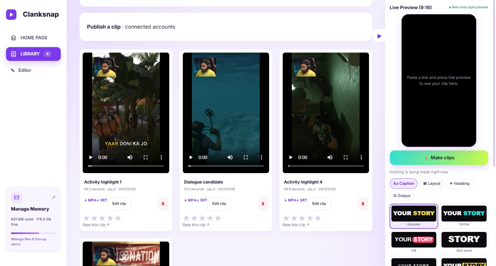
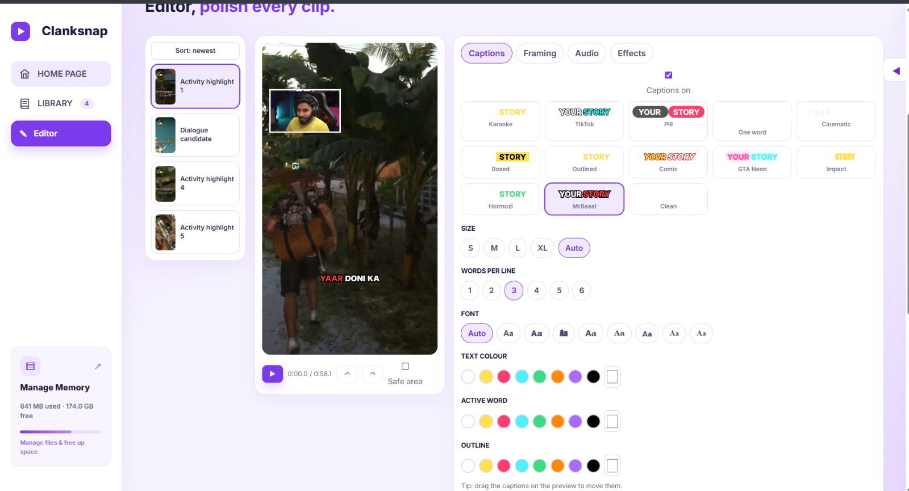

# ClankSnap 🎬

### AI-Powered Video Clipping & Short-Form Content Creation

ClankSnap is an AI-powered video clipping application designed to simplify the process of transforming long-form videos into engaging, shareable short clips.

It combines automated video processing, speech recognition, intelligent clip generation, and editing capabilities to help creators produce short-form content efficiently.

---

## ✨ Features

### 🎥 Video Processing
- Import videos using supported video URLs.
- Upload local video files.
- Process videos for short-form content creation.
- Select output quality where supported.

### 🤖 AI-Powered Clipping
- Generate short clips from longer videos.
- Use AI-assisted processing to identify interesting moments.
- Generate captions using speech recognition.
- Reduce manual effort in video editing.

### 📝 Caption Editing
- Generate subtitles automatically.
- Customize caption appearance.
- Adjust caption styling and presentation.
- Export subtitle files where supported.

### 📚 Clip Library
- View previously generated clips.
- Preview saved clips.
- Access clip information and metadata.
- Manage saved clips.

### 🎨 Video Editor
- Preview selected clips.
- Customize captions.
- Adjust video framing.
- Access audio and visual editing controls.
- Export finished content where supported.

---

## 🖥️ Application Preview

The following screenshots demonstrate the ClankSnap interface.

### Home Dashboard



### Clip Library



### Video Editor



---

## 🛠️ Technology Stack

| Technology | Purpose |
|---|---|
| React | Frontend user interface |
| Vite | Frontend development and build tool |
| HTML5 | Application structure |
| CSS3 | Styling and responsive layouts |
| JavaScript | Frontend functionality |
| Python | Backend development |
| FastAPI | Backend API framework |
| Faster-Whisper | Speech recognition |
| Ollama | Local AI model integration |
| OpenCV | Video processing |
| FFmpeg | Video and audio processing |
| yt-dlp | Video downloading |
| Streamlink | Stream handling |
| Git & GitHub | Version control |

---

## 🏗️ Project Architecture

ClankSnap follows a frontend-backend architecture.

```text
                 CLANKSNAP
                     |
          +----------+----------+
          |                     |
      FRONTEND                BACKEND
          |                     |
       React                  Python
          |                     |
        Vite                 FastAPI
          |                     |
          |          +----------+----------+
          |          |          |          |
          |       AI Models  Video      Audio
          |                  Processing  Processing
          |          |          |          |
          +----------+----------+----------+
                     |
              Generated Clips
                     |
               User Interface
```

---

## 📁 Project Structure

```text
ClankSnap/
│
├── frontend/
│   ├── public/
│   ├── src/
│   ├── index.html
│   └── package.json
│
├── docs/
│   └── screenshots/
│       ├── home-page.jpeg
│       ├── library.jpeg
│       └── editor.jpeg
│
├── README.md
├── LICENSE
└── Backend files
```

*Note: The structure above is a simplified overview. Actual backend files and additional project files may vary.*

---

## ⚙️ Installation & Setup

Follow these instructions to run ClankSnap locally on Windows.

### Prerequisites

Install the following tools before starting:

- [Node.js](https://nodejs.org/)
- [Python](https://www.python.org/)
- [Git](https://git-scm.com/)
- [FFmpeg](https://ffmpeg.org/)
- [Ollama](https://ollama.com/)

### 1. Clone the Repository

```bash
git clone https://github.com/Ashwanikumar6/Clanksnap.git
```

### 2. Navigate to the Project

```bash
cd Clanksnap
```

### 3. Install Frontend Dependencies

```bash
cd frontend
npm install
```

### 4. Start the Frontend

```bash
npm run dev
```

Vite will display the local development URL in the terminal. Open that URL in your browser.

### 5. Start the Backend

Open another terminal window and navigate to the project root directory.

Install the backend dependencies using the project's dependency file, if provided:

```bash
pip install -r requirements.txt
```

Start the FastAPI backend using the actual application entry point configured in the project.

For example, if the application entry point is `main.py`:

```bash
uvicorn main:app --reload
```

---

## 🚀 Development Workflow

The project uses Git and GitHub for collaborative development and version control.

Recommended workflow:

1. Pull the latest changes from the main branch.
2. Create a feature branch for your work.
3. Implement and test your changes.
4. Commit your updates with meaningful messages.
5. Push your branch to GitHub.
6. Review and merge changes into the main branch.

Example:

```bash
git checkout main
git pull origin main

git checkout -b feature-name

git add .
git commit -m "Add feature description"

git push origin feature-name
```

---

## 🔮 Future Enhancements

Planned improvements may include:

- More advanced AI-based highlight detection.
- Improved caption customization.
- Additional video export options.
- Enhanced clip management.
- Better video preview and editing controls.
- Performance and processing optimizations.
- Improved user experience and responsiveness.

---

## 📌 Project Goals

ClankSnap aims to make short-form video creation more accessible by combining AI-powered automation with simple editing tools.

The project focuses on:

- Reducing manual video editing effort.
- Simplifying short-video generation.
- Improving content creation workflows.
- Providing an organized environment for managing clips.
- Making AI-assisted video editing easier to use.

---

## 📄 License

Refer to the repository's `LICENSE` file and all applicable third-party license and copyright notices for the terms governing the software.

Components incorporated from external projects remain subject to their applicable license requirements. Check these obligations before redistributing or modifying the software.

---

<p align="center">
  <b>ClankSnap — Create More. Edit Less. Share Faster.</b>
</p>